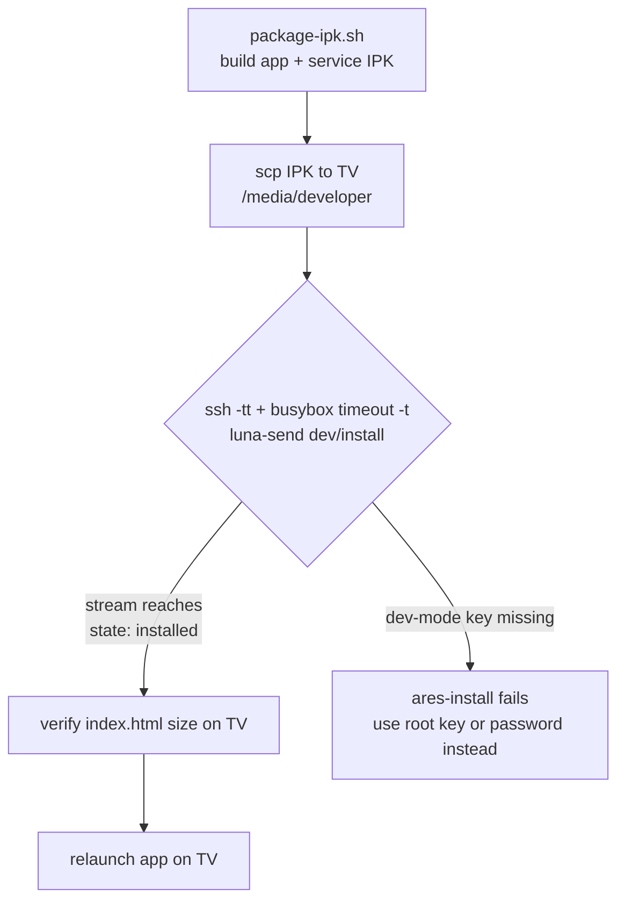

# Deploy Sendspin WebOS to a webOS TV

One command does everything (build → copy → install → verify):

```sh
scripts/deploy-tv.sh [HOST] [PASSWORD]
# defaults: HOST=192.168.1.32  APP_ID=com.sendspin.webos  KEY=~/.ssh/lgtv
# env: TV_HOST, TV_KEY, TV_PASS, APP_ID, SKIP_BUILD=1 (reuse existing dist/*.ipk)
```

## Auth: key first, password only as a fallback

The script uses the root SSH key at `~/.ssh/lgtv` (or `TV_KEY`) when that file exists, and
`sshpass` with `TV_PASS`/`PASSWORD` (default `alpine`) otherwise.

Why: Homebrew Channel's `/var/lib/webosbrew/startup.sh` sets the placeholder root password
`alpine` at each boot **only if `/home/root/.ssh/authorized_keys` does not exist**. A TV with
an authorized key (Dan Cave has the `homeassistant-lgtv` key) has no working `alpine`
password, and SSH says `Permission denied`. A TV with no `authorized_keys` (Bedroom) still
takes `alpine`. Do not add a key to a TV that relies on the password without installing
your key everywhere you need it, because the next reboot drops the placeholder password.

To get the key: save the 1Password document `LGTV Home Assistant SSH key` (Private vault) to
`~/.ssh/lgtv` and `chmod 600` it. Its public half (comment `homeassistant-lgtv`) is already in
Dan Cave's `authorized_keys`. For another TV, append `~/.ssh/lgtv.pub` to its
`/home/root/.ssh/authorized_keys` (mode 600, directory mode 700).

Prefer this script. Only hand-run the steps below when debugging the script itself.

## Why not `ares-install`

`ares-install -d <device>` needs the LG dev-mode SSH **key** (user `prisoner`, port 9922). It
commonly fails with `All configured authentication methods failed`. We use plain **root SSH**
(the key above, or the `alpine` placeholder password) + the on-TV dev install Luna service
instead.

## Non-obvious gotchas (already handled in the script)

- **`ssh -tt` is mandatory.** `luna-send -i` streams install status only over a
  real PTY. Without a TTY the call returns `EXIT=0`, prints nothing, and
  installs nothing. This is the trap that eats iterations.
- **busybox `timeout` syntax is `-t SECONDS`.** GNU `timeout 25 cmd` fails with
  `can't execute '25': No such file or directory`.
- **Copy the IPK to the TV first.** `dev/install` reads `ipkUrl` from the TV
  filesystem (`scp` to `/media/developer/`), not from the host.
- **Verify by size/marker.** Installed app lives at
  `/media/developer/apps/usr/palm/applications/com.sendspin.webos/`. A stale
  install leaves the old `index.html` size; `grep -c <marker>` confirms the new
  code landed. Success state in the stream is `"state": "installed"`.

## Manual fallback

```sh
H=192.168.1.32; A=com.sendspin.webos
S="-o StrictHostKeyChecking=no -o UserKnownHostsFile=/dev/null -i $HOME/.ssh/lgtv -o IdentitiesOnly=yes"
./package-ipk.sh
scp $S dist/*.ipk root@$H:/media/developer/x.ipk
ssh -tt $S root@$H \
  "timeout -t 90 luna-send -i -f luna://com.webos.appInstallService/dev/install \
   '{\"id\":\"$A\",\"ipkUrl\":\"/media/developer/x.ipk\",\"subscribe\":true}'"
```

## Flow


